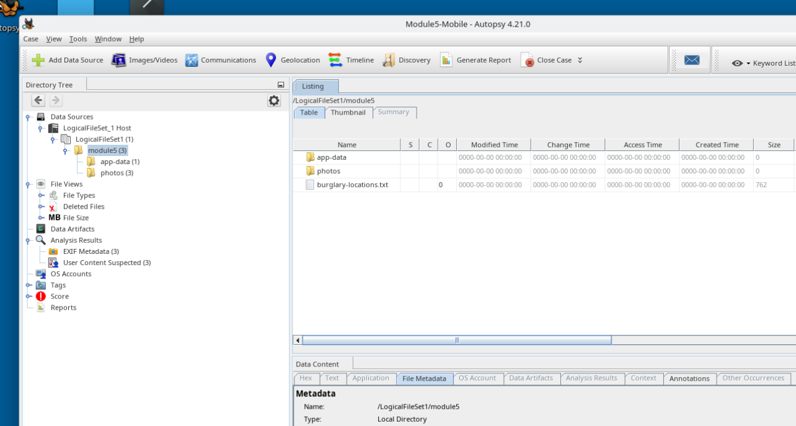
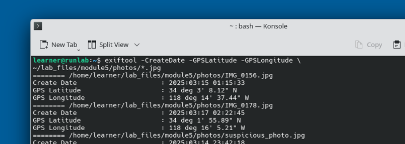
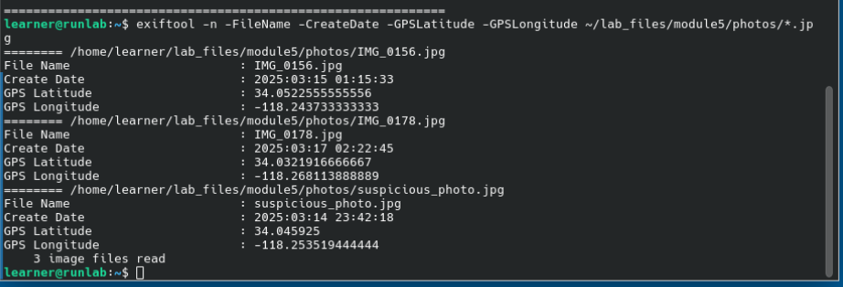
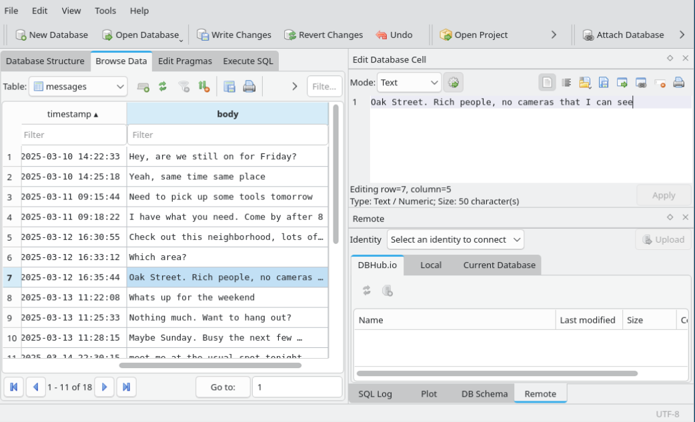
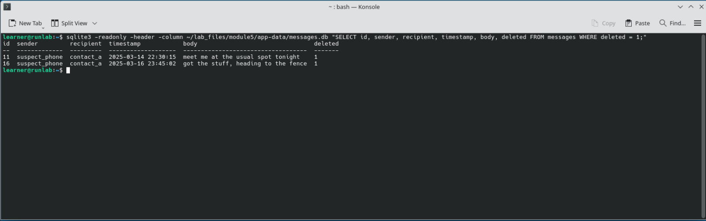

# Mobile Device Forensics Investigation

## Case Overview

| Category | Details |
|---|---|
| Portfolio Case Reference | 2025-03847 |
| Investigation | Mobile Device Forensics |
| Evidence Type | Logical Smartphone Extraction |
| Environment | Linux |
| Case Type | Simulated Burglary Investigation |
| Training Provider | NetDevGroup Digital Forensics |

## Background

Detectives investigating a series of residential burglaries
suspected that multiple individuals were coordinating criminal
activities through mobile communications.

A simulated smartphone extraction was supplied for forensic
examination to identify relevant communications, photographic
metadata, geographic locations and potential relationships
between individuals.

The investigation focused on establishing whether mobile
device artefacts could corroborate known burglary locations
and timelines.

## Related Investigation

This project complements the earlier evidence collection
and preservation exercise:

[Digital Forensics Evidence Collection Case](https://github.com/Kha-cyber-IT/digital-forensics-evidence-collection-case)

Both projects form part of an educational forensic portfolio.
They are separate simulated exercises connected through a
common case narrative, not verified examinations of the
same physical device.

## Investigation Objectives

- Validate inherited forensic evidence.
- Identify mobile device artefacts.
- Extract photographic GPS metadata.
- Correlate evidence with burglary locations.
- Examine communication records.
- Retrieve logically deleted messages.
- Document findings and forensic limitations.

## Tools and Technologies

| Tool | Application |
|---|---|
| Autopsy 4.21.0 | Mobile evidence examination |
| ExifTool | EXIF and GPS metadata extraction |
| DB Browser for SQLite | Application database examination |
| SQLite3 CLI | Read-only database queries |
| Linux | Forensic examination environment |

## Investigation Methodology

1. Forensic case validation
2. Mobile artefact examination
3. Photographic metadata extraction
4. Geographic and temporal correlation
5. SQLite database examination
6. Deleted message analysis
7. Forensic reporting

## Key Findings

- Three photographs contained GPS coordinates and timestamps.
- Two photographs closely correlated with burglary locations
  and reported time windows.
- One photograph demonstrated weaker spatial and temporal
  correlation.
- Communications referenced Oak Street before the burglary.
- Two logically deleted messages remained accessible within
  the messaging database.

## Investigation Reports

- [Forensic Examination Report](reports/forensic-examination.md)
- [GPS and Metadata Analysis](reports/gps-analysis.md)
- [Communication Evidence Analysis](reports/communication-analysis.md)
- [SQL Investigation Query](queries/deleted-messages.sql)
- [Technical Commands](reports/technical-commands.md)

## Skills Demonstrated

- Mobile Forensics
- Digital Evidence Analysis
- Metadata Analysis
- Geolocation Analysis
- SQLite Forensics
- Timeline Analysis
- Artefact Analysis
- Evidence Correlation
- Forensic Documentation

## Evidence Screenshots

### 1. Mobile Evidence Examination — Autopsy

Initial examination of the logical smartphone extraction,
identifying application data, photographs and EXIF artefacts.

### 2. GPS Metadata Extraction — ExifTool

Extraction of GPS coordinates and creation timestamps
from three evidence photographs.

### 3. Geographic Evidence Correlation

Conversion of GPS coordinates into decimal degrees for
comparison against known burglary locations.

### 4. Communication Evidence — SQLite

Examination of messaging records containing references
to Oak Street before the reported burglary.

### 5. Logically Deleted Message Analysis

Read-only SQL examination identifying two message
records flagged as deleted within the application database.

## Disclaimer

This repository documents an educational digital forensic
simulation. No real criminal investigation or independent
physical smartphone acquisition was conducted.
